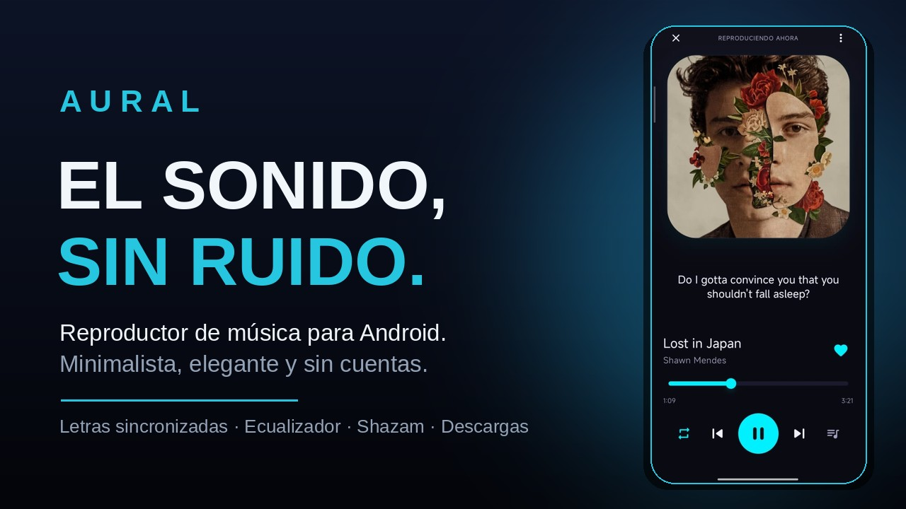
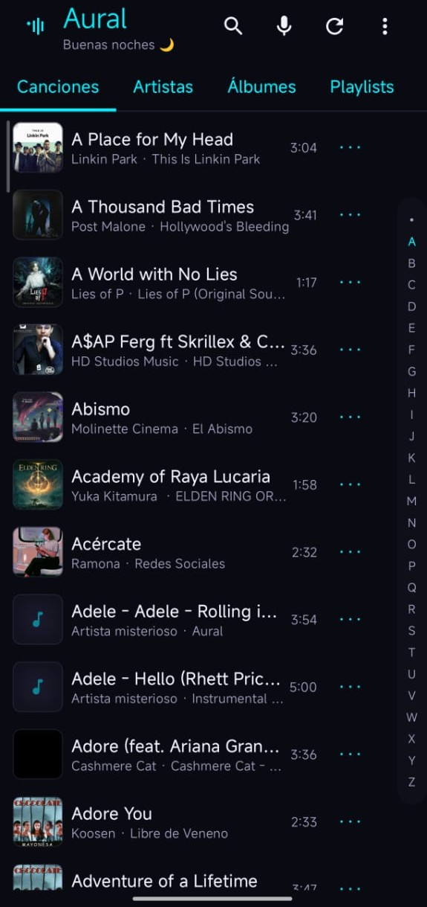
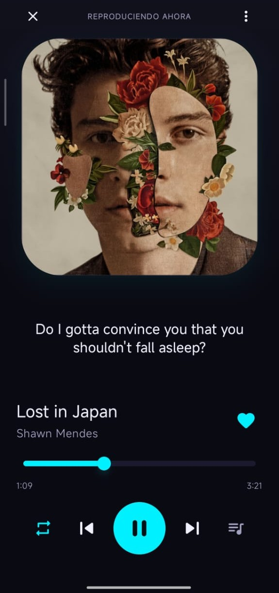
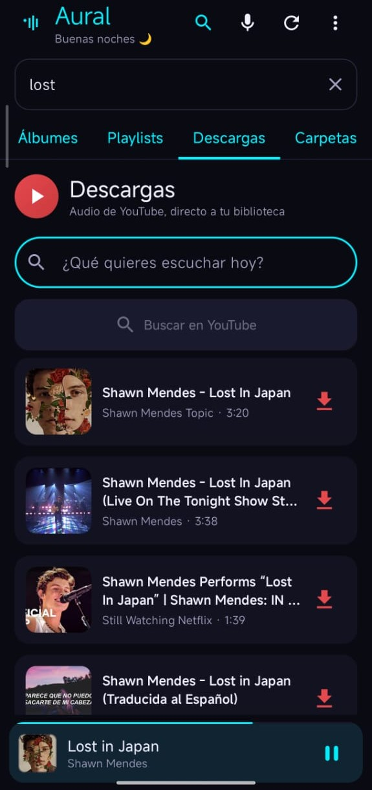
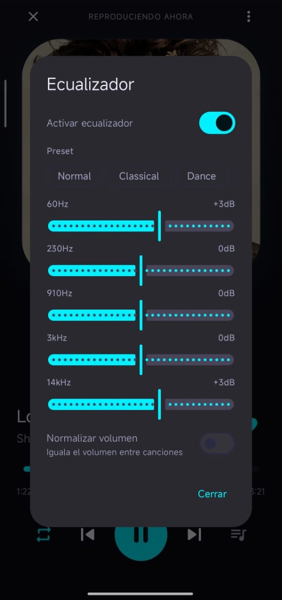
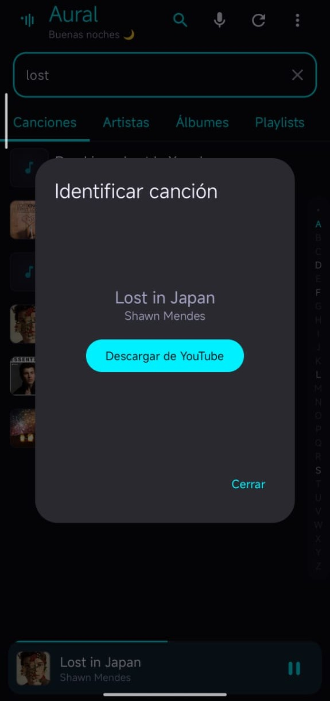

<div align="center">
  
  <h1>AuralPlayer</h1>
  <p><strong>El sonido, sin ruido.</strong></p>
  <p>
    <a href="https://github.com/Dah3l/AuralPlayer/releases/latest">
      
    </a>
  </p>
  <p>
    <a href="https://github.com/Dah3l/AuralPlayer/releases">
      
    </a>
  </p>
  <p>
    <a href="LICENSE"></a>
    
  </p>
</div>

Toda tu música en un solo lugar. Descarga, escucha, canta y comparte, sin cuentas, sin nube y sin rastreo. Tu biblioteca vive en tu teléfono y nada más. Gratis.

---

## Capturas

| Biblioteca | Reproduciendo ahora | Descargas de YouTube |
|---|---|---|
|  |  |  |

| Ecualizador | Identificar canción |
|---|---|
|  |  |

---

## Toda tu música, en un solo lugar

Tu biblioteca completa, organizada y lista en segundos: canciones, artistas, álbumes, playlists, descargas y carpetas. Búsqueda instantánea, índice alfabético para saltar a cualquier letra y actualización deslizando hacia abajo cuando agregas música nueva.

## Descarga música y llévala contigo

Busca y descarga audio de YouTube sin salir de la app. Todo lo que bajas se organiza solo en tu playlist Descargas, y puedes cancelar una descarga cuando quieras. Funciona desde Android 8.0 en adelante.

## Canta cada canción

Letras sincronizadas que avanzan con la música, en una vista completa con portada y progreso. ¿Tu canción no trae letra? Agrega tu propio archivo .lrc o búscala en línea gratis, sin registros ni claves.

## Comparte lo que escuchas

Con Aural Cards, elige hasta 6 versos y crea una tarjeta con la portada y la letra, lista para compartir en WhatsApp, Instagram o Telegram. O guárdala directo en tu galería, en la carpeta Aural.

## ¿Qué canción es esa?

Escucha lo que suena a tu alrededor, descubre qué es y descárgala al instante a tu biblioteca. Con un toque en el botón flotante, o desde los ajustes rápidos sin siquiera abrir la app.

## Sonido a tu manera

Ecualizador de 5 bandas con presets, volumen parejo entre canciones, refuerzo para auriculares y altavoces modestos, velocidad ajustable, apagado automático y reproducción sin pausas entre canciones. Tu música, como a ti te gusta.

## Hazla tuya

16 temas de color con selector a pantalla completa, para que la app se vea como tú quieras. Portadas propias: busca en línea o elige una foto de tu galería, recórtala a tu gusto para tus playlists y corrige título, artista y álbum sin salir de la app.

## Tus playlists, como quieras

Crea, renombra, elimina y reordena arrastrando. Importa y exporta en .m3u para respaldar o pasar tus listas a otro dispositivo. Favoritas y Descargas siempre a mano.

## Reproduce sin parar

Cola visible y reordenable, repetir y aleatorio en un solo botón, y el botón de cada playlist que suena al instante desde la primera canción. La música sigue con la pantalla apagada y se controla desde tus auriculares, el Bluetooth y la pantalla de bloqueo.

## Siempre al día

Aural te avisa cuando hay una versión nueva, y puedes buscar actualizaciones desde el menú cuando quieras. Sin cuentas nuevas ni permisos nuevos.

---

## Descarga

- **Estable:** [última Release de GitHub](https://github.com/Dah3l/AuralPlayer/releases/latest) — descarga el APK e instálalo (puede que Android pida permitir la instalación desde el navegador o el explorador de archivos).
- También se distribuye por **Telegram**.

---

## Para desarrolladores

Stack: Kotlin 2.0.21, Jetpack Compose + Material 3, Media3 / ExoPlayer 1.4.1, DataStore Preferences. MinSdk 26, targetSdk 34. Arquitectura sencilla sin librerías de DI externas: contenedor manual en `AuralApp` (Repositorio → ViewModel → Compose) y `PlaybackManager` como puente con el servicio Media3.

```bash
git clone https://github.com/Dah3l/AuralPlayer.git
cd AuralPlayer
./gradlew assembleDebug
```

Permisos que pide la app, y nada más: audio (Android 13+) o almacenamiento (Android 12 o anterior), notificaciones (Android 13+), servicio en primer plano y wake lock para seguir sonando con la pantalla apagada.

Historial completo de cambios en [CHANGELOG.md](CHANGELOG.md). Hoja de ruta: widget en pantalla de inicio, música en línea y Android Auto.

---

## Licencia

Este proyecto está bajo la **GNU General Public License v3.0** — ver [LICENSE](LICENSE) para más detalles.

Copyright (C) 2026 Dahel

---

Hecho con Jetpack Compose. Si te gusta, dale una estrella al repositorio.
